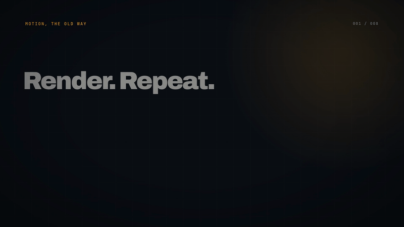

# TrueMotion

[](https://github.com/instax-dutta/truemotion/actions/workflows/ci.yml)
[](LICENSE)
[](https://nodejs.org)
[](https://modelcontextprotocol.io)

# Describe the video. Your agent makes it.

**TrueMotion is an open-source motion-graphics studio that runs as a stdio MCP server. A coding agent writes self-contained HTML scenes, gets rendered frames and objective measurements back after every change, corrects its own work, and exports a frame-accurate MP4. No GUI, no account, no cloud, no model SDK, no per-render fee.**



*The 37-second [launch film](examples/launch-out/launch-film.mp4), authored end to end through TrueMotion's MCP tools. The "returned frames" you see are real renderer output. [Storyboard and verification notes](examples/launch-out/STORYBOARD.md).*

---

## What is TrueMotion?

TrueMotion gives an AI agent three things it needs to make a video without guesswork:

1. **Tools it can call.** Eleven stdio MCP tools cover authoring, auditing, asset optimisation and rendering. Any MCP-capable harness works: Claude Code, Codex, Cursor, OpenCode and others.
2. **Eyes on its own work.** Every scene write returns three rendered frames plus measurements: pixel-change ratios, dead holds, duration mismatches, external requests, script errors, clipped actors and tiny text. The agent can see a problem and fix it before you watch the film.
3. **A renderer that finishes the job.** Frames are seeked from a single paused GSAP timeline, piped to ffmpeg in bounded batches, and encoded locally. Long renders can be checkpointed and resumed after a crash.

Everything runs offline. The package is about 730 kB, the dependency tree is 56.1 MiB, and rendering needs only Node.js 20+, ffmpeg and an installed Chrome or Chromium.

## Why agents can actually use it

- **Feedback is measured, not decorative.** A static slide, a dead hold or a clipped actor is reported as a number and a frame, not a vibe. A visible jump at an evolved cut is rejected and both frames are attached to the error.
- **Scenes are debuggable.** One HTML document per scene with one timeline on `window.__SCENE_TIMELINE__`. A static lint rejects anything that would break frame seeking: `from()`, timers, CSS keyframes, transitions or external URLs.
- **Nothing is locked behind a vendor.** No Electron process, no embedded Claude/Codex SDK, no API keys, no license gate. Your harness talks stdio MCP; your machine renders the MP4.
- **It handles long jobs.** Frames stream to ffmpeg in bounded batches, so memory stays flat with video length. A 1200-frame, 1080p, two-minute render held a 1278 MiB process-tree peak and ran 2.6× faster after page reuse. Interrupted renders resume from byte-verified, digest-checked segments.
- **You can verify every claim.** 103 unit tests, pinned-browser golden frames, MCP end-to-end, crash, A/V, CSP, schema and concurrency suites all run in CI. Measured results are in [`docs/benchmarks/`](docs/benchmarks/).

## Install

```bash
git clone https://github.com/instax-dutta/truemotion.git
cd truemotion
npm install
```

You need **Node.js 20+**, **ffmpeg** on `PATH` (for `render` only), and **Chrome or Chromium** installed. TrueMotion uses `playwright-core` and never downloads a browser.

```bash
node bin/truemotion.mjs doctor   # reports browser, ffmpeg and state-file health
```

If your browser is in a non-standard location:

```bash
export TRUEMOTION_CHROME="/path/to/chrome"
```

## Connect your agent

Create a state file, then point your harness at the stdio server:

```bash
node bin/truemotion.mjs init truemotion-state.json --aspect 16:9
```

Add this to your harness's MCP config:

```json
{
  "mcpServers": {
    "truemotion": {
      "command": "node",
      "args": [
        "/absolute/path/to/truemotion/bin/truemotion.mjs",
        "serve",
        "--state", "/absolute/path/to/truemotion-state.json"
      ]
    }
  }
}
```

That is the whole setup. The agent can now author, audit and render a film without shell access. Optional `serve` flags:

- `--skill <dir>`: use a different motion-skill directory.
- `--assets <dir>`: where `{{ASSET:...}}` files and sketch PNGs live (defaults to `assets/` beside the state file).
- `--no-preview`: skip rendered frame feedback (faster, but the agent loses its eyes).

Install the motion-design references into your harness if you want them as native skills:

```bash
node bin/truemotion.mjs install-skill ~/.claude/skills/truemotion
node bin/truemotion.mjs install-skill ~/.agents/skills/truemotion
```

## How it works

1. **The agent reads the contract.** `read_skill` and `list_skills` load the scene format, motion rules and typography guidance on demand.
2. **The agent writes a scene.** `add_scene` and `patch_scene` take self-contained HTML with one paused GSAP timeline. Injections for GSAP, fonts, icons, assets, hand-drawn shapes, effects, CSS-3D stages, brand values and components are all resolved locally.
3. **The agent looks at the result.** Each write returns rendered checkpoint frames and measurements. `review_timeline` returns one contact sheet for the whole film.
4. **TrueMotion renders.** Playwright seeks the timeline frame by frame; PNG frames stream to ffmpeg in bounded batches. Crash-safe segments let a long render resume where it stopped.

## See it in action

```bash
npm run demo:launch   # 37s narrative launch film, 8 scenes, authored through MCP
npm run demo:pro      # 29s art-directed demo, includes an all-token scene
npm run demo          # 12s intro, smallest example of the tool contract
```

Outputs land in `examples/launch-out/`, `examples/pro-out/` and `examples/out/`. The launch film's feedback scene embeds frames rendered by TrueMotion itself. Regenerate the looping README GIF at any time with `npm run gif:launch`.

## TrueMotion vs alternatives

| | TrueMotion | OpenMotion | Remotion | Typical AI video generators |
| --- | --- | --- | --- | --- |
| License | MIT | Proprietary | Two-tier; company license for larger orgs | Varies, often subscription |
| Interface | stdio MCP for any agent | Electron GUI + embedded Claude/Codex SDK | React components | Web app |
| Runtime dependencies | Node, ffmpeg, local Chrome | Bundled Electron + model SDKs | Native compositor binaries | Cloud service |
| Network at render time | None | Vendor services | None by default | Required |
| Frame-accurate seeking | Yes, one paused GSAP timeline | Yes | Via React timeline | Usually no |
| Feedback to the authoring agent | Rendered frames + measured defects after every write | GUI review | Developer inspection | Preview and regenerate |
| Long renders | Bounded streaming + resumable digest-checked segments | Not documented | Standard render | Provider-managed |
| All documented authoring tokens local | Yes | Proprietary bundles | Not applicable | Not applicable |

TrueMotion was recovered by reverse engineering **OpenMotion 1.1.0** (an Electron + React app signed by "Meta Dots"). It keeps the useful tool contract, scene format and motion-design ideas, and drops everything tied to one vendor. All original proprietary documentation was replaced with MIT-licensed material; the provenance and rejected findings are recorded in [`docs/reverse-engineering/audit.md`](docs/reverse-engineering/audit.md).

## What you get

- **Eleven MCP tools:** `get_scenes`, `read_scene`, `update_scene`, `patch_scene`, `add_scene`, `read_skill`, `list_skills`, `view_sketch`, `review_timeline`, `render_video`, `optimize_assets`.
- **Twelve local injection tokens:** `{{GSAP}}`, `{{FONTS_CSS}}`, `{{W}}`, `{{H}}`, `{{ICON:...}}`, `{{ASSET:...}}`, `{{ROUGH}}`, `{{FX}}`, `{{SHADERS}}`, `{{THREE}}`, `{{BRAND:*}}`, `{{COMPONENT:*}}`, plus an injected `OMTyping` runtime.
- **Contract validation** with a static seek-safety lint, evolve reads with measured actor exit states, and rendered-frame feedback after each write.
- **Local rendering**: page-reuse pool, backpressure-aware ffmpeg streaming, checkpointed segments, cross-process state lock, and byte- and hash-verified resume.

## Render a video

```bash
node bin/truemotion.mjs render --state truemotion-state.json --out video.mp4 --fps 30 --crf 18
# fast draft at half resolution
node bin/truemotion.mjs render --state truemotion-state.json --out draft.mp4 --resolution 540p --fps 15
# loop and fade a music bed to the exact video length
node bin/truemotion.mjs render --state truemotion-state.json --out video.mp4 --audio music.mp3
# render only one beat
node bin/truemotion.mjs render --state truemotion-state.json --out beat.mp4 --start 4 --end 8
```

`--concurrency N` sets the number of browser pages (default 2) and is the main speed control. `--batch-size N` bounds in-memory frames (default 30); lower it on small machines. `--crf` defaults to 18.

For a long or fragile render, split it across invocations:

```bash
node bin/truemotion.mjs render --state state.json --out film.mp4 \
  --segment-size 240 --max-segments 2 --keep-checkpoints
node bin/truemotion.mjs render --state state.json --out film.mp4 \
  --segment-size 240 --resume
```

Completed segments are MPEG-TS files with a verified manifest. A resume rejects a changed state file, asset, audio bed, sketch, component or segment rather than muxing stale frames.

Other useful commands:

```bash
node bin/truemotion.mjs still --state state.json --out frame.png --scene 2 --time 1.5
node bin/truemotion.mjs optimize-assets ./assets --max-dimension 2200
node bin/truemotion.mjs validate-state --state state.json
```

## State file

Plain JSON, versioned and easy to commit:

```json
{
  "schemaVersion": 1,
  "projectId": "default",
  "aspect": "16:9",
  "resolution": "1080p",
  "brand": { "primary": "#F5A524", "background": "#0B0E14", "text": "#F3EFE9", "logo": "" },
  "components": {},
  "scenes": [
    { "id": "uuid", "name": "Opening", "durationSec": 6, "html": "<!doctype html>..." }
  ],
  "sketchRefs": [],
  "skillReadCache": {},
  "stats": { "readSkillCalls": 0, "writeSceneCalls": 0 }
}
```

Files without `schemaVersion` are treated as legacy v0, migrated with a warning and saved on the next write. Files from a newer schema are rejected. Concurrent writes from multiple agents are serialised by a cross-process lock, so no update is lost.

## FAQ

**Does TrueMotion need an API key or a paid service?**
No. Rendering is local and offline. You supply Node.js, ffmpeg and an installed browser. There is no account, cloud call or model SDK in the render path.

**Which AI agents can drive it?**
Any harness that speaks stdio MCP. It is tested with the MCP SDK and used from Claude Code, Codex, Cursor and OpenCode-style setups. The harness needs no vendor-specific integration.

**Can an agent see and fix its own mistakes?**
Yes. Every write returns rendered checkpoint frames and measured defects. `review_timeline` returns a contact sheet for the whole film. Clipped actors, tiny text, dead holds and mismatched durations are reported explicitly.

**How does it compare with plain HTML video tools?**
Scenes are seek-safe by construction: one paused GSAP timeline per scene, no timers or CSS animation, deterministic frames, and local injection for fonts, icons and effects. Contract validation rejects patterns that would break a frame-by-frame render.

**Can it render long videos without running out of memory?**
Yes. Frames stream to ffmpeg in bounded batches and browser pages are reused across scenes. Peak memory is governed by the batch size and browser pool, not video length. A 1200-frame 1080p run peaked at 1278 MiB; `--concurrency 1` lowers that to about 977 MiB at 400 frames.

**What happens if a render crashes?**
Segments already written are kept. A later `--resume` skips verified segments, re-encodes invalid ones and concatenates the final film. The manifest hashes scenes, assets, audio, sketches and each segment, so a changed input is rejected instead of silently producing a mismatched video.

**Is it really free?**
The source is MIT licensed. Dependencies keep their own licenses, documented in [`NOTICE.md`](NOTICE.md). npm publication is currently paused; the package is verified packable and the release workflow is ready.

## Scope and limits

- All documented authoring tokens are supported locally. `{{THREE}}` is a CSS-3D stage helper, not a WebGL renderer with lighting or materials.
- There is no GUI, brand-kit scraper or in-app sound editor. The CLI muxes one audio bed with `--audio`.
- Frame-by-frame seeking is deterministic but slower than a GPU compositor for very long films. Use a lower `--fps` for drafts.

## Documentation

- [`docs/dox/`](docs/dox/) - full reference: getting started, architecture, CLI and MCP tool docs.
- [`examples/launch-out/STORYBOARD.md`](examples/launch-out/STORYBOARD.md) - how the launch film was designed and verified.
- [`docs/reverse-engineering/audit.md`](docs/reverse-engineering/audit.md) - what was adopted, replaced or rejected, and why.
- [`docs/benchmarks/`](docs/benchmarks/) - package footprint, frame rates, long-form memory and A/V drift.

## Verification

```bash
npm test
npm run selftest
npm run test:e2e
npm run test:crash
npm run test:audio-resume
npm run test:csp
npm run test:mcp-schema
npm run test:concurrent
npm run test:contention
npm pack --dry-run   # prepack: tests + tarball verification
npm run bench:longform
```

Opt-in suites cover scene reorder, render-setting changes, component changes, sketch changes, combined mutation, mixed-checkpoint recovery, same-size corruption and a two-minute A/V resume. See [`CONTRIBUTING.md`](CONTRIBUTING.md) for the full list.

CI runs pinned-browser golden frames plus the MCP, crash, audio, CSP, schema, concurrency and resume suites on Node 20 and 22. A nightly workflow runs the two-minute A/V resume and the full 1200-frame benchmark with performance guards.

## Contributing

Contributions are welcome. The most useful help is a scene that breaks a measurement, or a better measurement with a test. Read [`CONTRIBUTING.md`](CONTRIBUTING.md) for setup, [`NOTICE.md`](NOTICE.md) for provenance and third-party licenses, and [`CHANGELOG.md`](CHANGELOG.md) for release history.

## Licensing note

Source in `src/`, `bin/` and `test/`, and all references in `skill/`, are MIT licensed. Dependencies keep their own licenses. GSAP, fonts and icon data are read from installed npm packages at render time, not copied into this repository. All original proprietary documentation was replaced with original MIT-licensed material, so the repository is free to redistribute in full.
