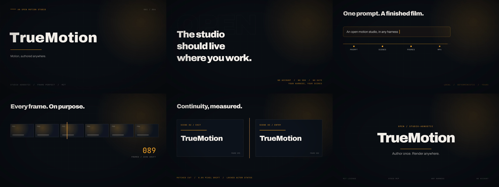

# TrueMotion

[](https://github.com/instax-dutta/truemotion/actions/workflows/ci.yml)
[](LICENSE)

An open, harness-agnostic core for authoring and rendering motion-graphics video scenes.



The [finished 25-second demo](examples/pro-out/pro-demo.mp4) and its
[state file](examples/pro-out/state.json) are in this repository. Regenerate them with
`npm run demo:pro`.

This project was recovered by reverse engineering **OpenMotion 1.1.0** (`/Applications/OpenMotion.app`, an Electron + React app signed by "Meta Dots", updater `anovius/openmotion`). The original ships its tools through an embedded MCP server wired to the Claude Agent SDK and Codex SDK. TrueMotion keeps the useful part, the tool contract, the scene format, and the motion-design references, and drops everything that ties it to one vendor: no Electron UI, no account, no license gate, no model SDK. The result is a plain stdio MCP server that any coding agent can drive, plus a renderer you can run yourself.

## What you get

- Eleven MCP tools: `get_scenes`, `read_scene`, `update_scene`, `patch_scene`, `add_scene`, `read_skill`, `list_skills`, `view_sketch`, `review_timeline`, `render_video`, `optimize_assets`. An agent can author, audit, optimise assets and render a film without shell access.
- Scene format: one self-contained HTML document per scene with a single paused GSAP timeline on `window.__SCENE_TIMELINE__`. Injection tokens `{{GSAP}}`, `{{FONTS_CSS}}`, `{{W}}`, `{{H}}`, `{{ICON:...}}`, `{{ASSET:...}}`, `{{ROUGH}}`, `{{FX}}` and the `OMTyping` runtime are resolved locally.
- Contract validation (including a static seek-safety lint that rejects `from()`, external scripts or URLs, timers, `requestAnimationFrame`, CSS keyframes and transitions), evolve/digest reads, and rendered frame feedback after each write. Feedback is measured, not decorative: pixel-diff ratios for static slides and dead holds, duration/timeline mismatches, external requests, script errors, clipped actors and text under 18px. Evolved scenes get measured actor exit states, and a visible jump at an evolved cut is rejected with the two frames attached.
- Rendering: Playwright seeks the timeline frame-by-frame, ffmpeg encodes the frames to MP4. No cloud service involved. Seeks fire GSAP `onUpdate` callbacks, so proxy-driven counters and typed text export correctly on a cold seek.

## Install

```bash
cd truemotion
npm install
```

TrueMotion uses `playwright-core` and does **not** download a browser. Install
Chrome or Chromium on the host, or point it at an existing binary:

```bash
export TRUEMOTION_CHROME="/Applications/Google Chrome.app/Contents/MacOS/Google Chrome"
# or pass --chrome <path> to render/serve
truemotion doctor   # reports which browser will be used
```

If no browser is found, rendering fails with a clear message rather than
silently downloading one. You also need `ffmpeg` on `PATH` for `render`
(preview frames during MCP writes do not use it).

## Use with any harness

Create a state file, then point your harness at the stdio server:

```bash
node bin/truemotion.mjs init truemotion-state.json --aspect 16:9
```

MCP configuration (the exact file name differs by harness):

```json
{
  "mcpServers": {
    "truemotion": {
      "command": "node",
      "args": ["/absolute/path/to/truemotion/bin/truemotion.mjs", "serve",
               "--state", "/absolute/path/to/truemotion-state.json"]
    }
  }
}
```

That is all that is required: stdio MCP is supported by Claude Code, Codex, Cursor, OpenCode, and most other agents. No API keys, no vendor SDK, no Electron process.

Optional flags for `serve`:

- `--skill <dir>`: use a different motion-skill directory.
- `--assets <dir>`: where `{{ASSET:...}}` files and sketch PNGs live (defaults to `assets/` beside the state file).
- `--no-preview`: skip rendered frame feedback (faster, but the agent cannot see its own scenes).

### Skill installation

The agent needs the motion-design references. Either let the agent call `read_skill` through MCP, or copy the skill into your harness's skill folder:

```bash
node bin/truemotion.mjs install-skill ~/.claude/skills/truemotion
node bin/truemotion.mjs install-skill ~/.agents/skills/truemotion
```

## Render a video

```bash
node bin/truemotion.mjs render --state truemotion-state.json --out video.mp4 --fps 30 --crf 18
# fast draft at half resolution
node bin/truemotion.mjs render --state truemotion-state.json --out draft.mp4 --resolution 540p --fps 15
# optional music bed, looped and faded in/out around the video
node bin/truemotion.mjs render --state truemotion-state.json --out video.mp4 --audio music.mp3
```

`--start 4 --end 8` renders only that global time range, which is useful for debugging one beat. `--concurrency N` renders frames on N browser pages in parallel and is the main speed control (default 2). Frame order is preserved exactly; content is seek-deterministic, though subpixel antialiasing can vary marginally with the number of concurrent pages. `--crf` defaults to 18 (higher quality than ffmpeg's default). `--audio` loops the file, fades it in and out, and cuts it to the video length.

Large project assets can be downscaled and recompressed locally. Filenames are
preserved so `{{ASSET:...}}` tokens keep working:

```bash
node bin/truemotion.mjs optimize-assets ./assets --max-dimension 2200
```

The same operation is available to agents as the `optimize_assets` MCP tool.
It is a standalone ffmpeg implementation; no Electron or cloud service is involved.

For frame-accurate QA without ffmpeg, export a single PNG:

```bash
node bin/truemotion.mjs still --state truemotion-state.json --out frame.png --scene 2 --time 1.5
```

Call `review_timeline` through MCP before finishing a video. It audits every scene and returns a short note plus one contact sheet of middle frames, so the connected model can fix its own work with a small image payload. Pass `contactSheet: false` to receive full-size frames instead.

## Example

`examples/intro-demo.mjs` authors a three-scene, 12-second intro entirely through the MCP tools (title reveal, capability assembly with an evolved matched cut, outro lockup) and renders it. Run it to see the tool contract in action:

```bash
node examples/intro-demo.mjs
```

The generated state and MP4 land in `examples/out/` (gitignored).

For a larger, art-directed piece, run `node examples/pro-demo.mjs`. It authors six scenes (kinetic wordmark, manifesto typography, prompt-to-film pipeline with typing, frame/count-up data visual, measured-continuity panels, outro lockup) through the same MCP tools, runs `review_timeline`, and renders a 25-second 1080p H.264 film with a generated stereo ambient score into `examples/pro-out/`. The score is produced by `examples/ambient.py` (Python 3 with numpy): an Am-F-C-G-Am pad with sub layer, detuned voices, soft plucked arpeggio, breathing air texture, short feedback delays and fades, encoded to AAC. Every scene in it passes the motion audit with measured build and resolve change.

## State file

Plain JSON, so it is easy to inspect or version:

```json
{
  "projectId": "default",
  "aspect": "16:9",
  "scenes": [
    { "id": "uuid", "name": "Opening", "durationSec": 6, "html": "<!doctype html>..." }
  ],
  "sketchRefs": [],
  "skillReadCache": {},
  "stats": { "readSkillCalls": 0, "writeSceneCalls": 0 }
}
```

This is intentionally compatible with OpenMotion's scene tool state, so a project authored there can be opened here and vice versa.

## Scope and limits

- Supported injection tokens are listed above. `{{ROUGH}}` and `{{FX}}` are small local deterministic helpers (`OMRough`, `OMFX`) with no third-party dependency. The remaining original-only tokens (`{{THREE}}`, `{{SHADERS}}`, `{{BRAND:*}}`, `{{COMPONENT:*}}`) are rejected with a clear error rather than silently mis-rendered.
- There is no GUI, brand-kit scraper or in-app sound editor. The CLI can mux a single audio bed with `--audio`, but there is no timeline-level mixing.
- Frame-by-frame seeking is deterministic but slow for long videos; use a lower `--fps` for drafts.

## Documentation

Full documentation lives in [`docs/dox/`](docs/dox/): getting-started, architecture, reference, contributing.

## Contributing

The formal reverse-engineering audit, including rejected findings and their
rationale, is in [docs/reverse-engineering/audit.md](docs/reverse-engineering/audit.md).

Contributions are welcome. See [CONTRIBUTING.md](CONTRIBUTING.md) for setup and
ideas, [NOTICE.md](NOTICE.md) for provenance and third-party licenses, and
[CHANGELOG.md](CHANGELOG.md) for the release history. The most useful help is a
scene that breaks a measurement, or a better measurement with a test.

## Licensing note

All source in `src/`, `bin/` and `test/`, and all reference documents in `skill/`, are MIT licensed (see `LICENSE`). Dependencies keep their own licenses; see [NOTICE.md](NOTICE.md). The original OpenMotion documentation that early versions carried has been replaced with original MIT-licensed material, so the repository is free to redistribute in full. Bundle versions of GSAP, fonts and Simple Icons are read from the installed npm packages at render time, not copied into this repo.

## Verification

```bash
npm test
npm run selftest
npm pack --dry-run
npm run benchmark -- --write   # records docs/benchmarks/latest.md
npm run goldens                # regenerate pinned golden frames after renderer changes
```

CI runs a pinned-Chromium golden-frame regression job. The fixtures are
font-free geometric scenes rendered at 540p, so they stay stable across hosts;
set `TRUEMOTION_GOLDEN=1` to run that test locally.

Measured footprint and frame rates on one machine are recorded in
[docs/benchmarks/latest.md](docs/benchmarks/latest.md). Run the benchmark on
your own hardware to get comparable numbers; the npm package itself is about
430 KiB and does not include the rendered demo film.
